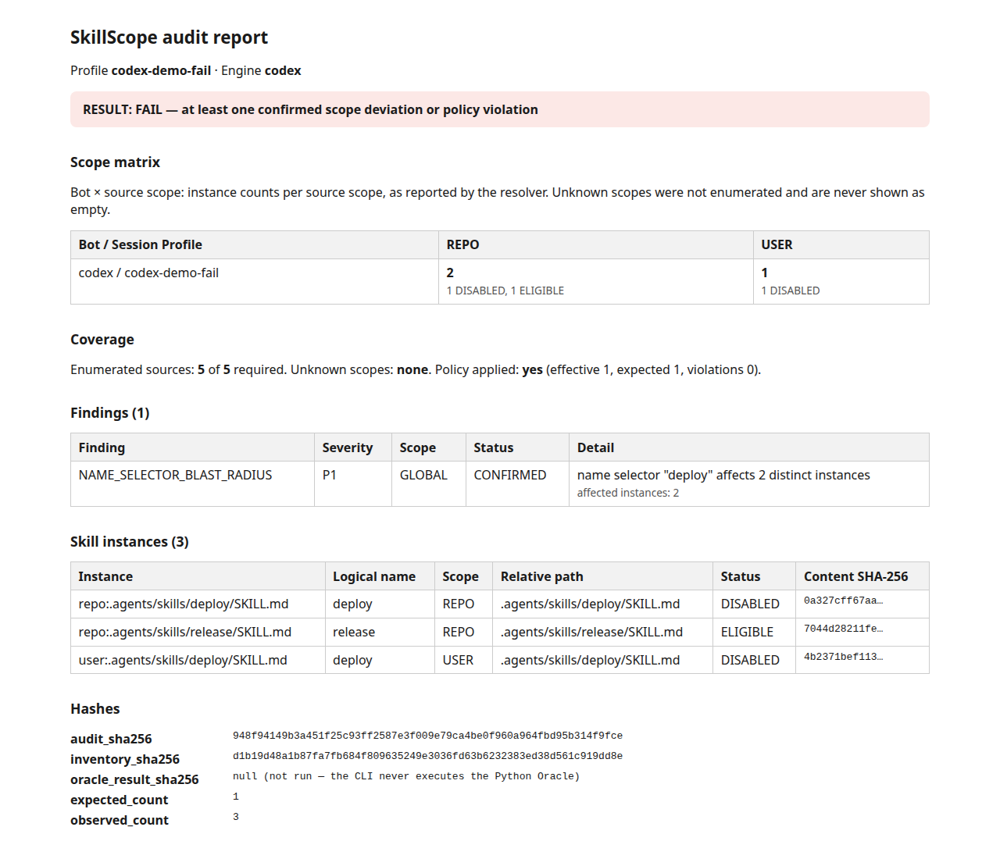

# SkillScope

**A skill was disabled — did every other skill with the same name disappear too? And which skills are sneaking into this bot from sources you never listed?**

SkillScope answers that question for Codex, Claude Code and OpenMausBot. It is a read-only, local-first auditor: it resolves every skill instance to its real source, compares the effective skill set against your policy, and reports PASS / FAIL / INCOMPLETE — with no account, no LLM, no network and no telemetry.

`Read-only` · `Local-first` · `No LLM` · `No telemetry`



*Screenshot: the static HTML report for the built-in synthetic demo (`codex-fail`). One `deploy` name selector disables two distinct skill instances; `release` stays eligible. Generated by `npm run demo`, no real skills involved.*

## Install

Requires Node.js 24 or later. No account, no API key, no network access at runtime.

```sh
git clone <this repository>
cd skillscope
npm ci
npm run build
```

## Quick start

```sh
# Create a starter profile in the current directory (synthetic home, never your real one)
node dist/cli/index.js init

# Audit it and write a JSON report next to the profile
node dist/cli/index.js audit --profile skillscope.json

# Same audit as a self-contained HTML report
node dist/cli/index.js audit --profile skillscope.json --format html

# Audit a repo directly (reads <dir>/skillscope.json; never guesses host roots)
node dist/cli/index.js audit --engine codex --cwd .

# CI mode: one machine-readable line on stdout, same exit codes
node dist/cli/index.js audit --profile skillscope.json --ci

# Re-run the frozen S0 gate (48 synthetic fixtures vs the independent Python Oracle)
node dist/cli/index.js verify --fixtures s0
```

See [docs/quickstart.md](docs/quickstart.md) for the full walkthrough and [docs/host-rules.md](docs/host-rules.md) for the per-host rules.

## Sample output

From the built-in synthetic demo (`npm run demo`; absolute paths elided):

```text
CODEX / profile: codex-demo-fail
  ✗ repo/.agents/skills/deploy/SKILL.md
  ✓ repo/.agents/skills/release/SKILL.md
  ✗ user/.agents/skills/deploy/SKILL.md
  ! NAME_SELECTOR_BLAST_RADIUS [P1] (GLOBAL): name selector "deploy" affects 2 distinct instances
  coverage: 5/5 sources enumerated
RESULT: FAIL
Report: .../codex-fail.report.json
```

## Exit codes

| Code | Result | Meaning |
| --- | --- | --- |
| 0 | PASS | All required sources enumerated; the effective set matches the policy. |
| 1 | FAIL | At least one confirmed scope deviation (for example a name selector disabling more than one instance, or a skill leaking from a forbidden source). |
| 2 | INCOMPLETE | A required source could not be enumerated (missing snapshot, unreadable config, unknown host version). The audit cannot prove the set is safe, so it never reports PASS. |
| 3 | Input / config error | Missing or malformed profile, invalid policy, unknown option. |
| 4 | Internal error | The audit or the report write failed unexpectedly. |

INCOMPLETE is never weakened to 0 — in CI mode included. A pipeline that cannot enumerate a required source must fail, not pass silently.

## What it catches

Finding IDs are frozen in the rule engine; the S0 gate replays 48 synthetic fixtures (8 control + 8 planted per host) against an independent Python Oracle — 48/48 parity, 24/24 planted defects detected, 0 false alarms on controls, 100 replays with a single gate hash.

- `NAME_SELECTOR_BLAST_RADIUS` — one name selector disables several distinct instances (same name, different paths are different instances).
- `SAME_NAME_COLLISION` — two instances share a logical name from different sources.
- `FAIL_OPEN_CONFIG` — a config that cannot be read or understood defaults to "everything enabled".
- `SCOPE_LEAK` — a skill from a forbidden source is in the effective set.
- `DISABLE_MISMATCH` — a skill disabled in the registered roots is still loadable from an unregistered directory.
- `SOURCE_NOT_ENUMERATED` — a required source (snapshot, plugin list, account sync) cannot be listed at all.

## Boundaries — what SkillScope does not do

- Never executes skill content. It reads `SKILL.md` frontmatter and host config; it never runs a skill.
- Never writes to a host directory. The only writes are the report file you asked for (and, for `init`, the profile file itself).
- Never uploads anything. Reports are local files; nothing leaves the machine.
- Never calls an LLM, a model API, or any network endpoint. `npm run test:offline` proves it: no network call sites in the code, no URLs in the reports, and the demo audits pass with the network blackholed.
- Never guesses. An unknown host version, a missing snapshot, or an unreadable settings layer is INCOMPLETE, not a silent default.
- Never merges two paths because their content is identical. Identity is `source + canonical path + content hash`; same content in different paths stays two instances. Symlink aliases of one real path merge and keep the alias.
- Never invents coverage. A source that was not enumerated is reported as unknown, never as an empty set.

## Hosts

| Host | Sources resolved | Rules |
| --- | --- | --- |
| Codex | `config.toml`, `bundled.json`, `plugins.json`; ADMIN / REPO / USER roots | Name selectors, plugin enablement, fail-closed on unreadable config |
| Claude Code | Settings layers (managed > user > project > local), marketplaces, extra plugin directories | `enabledPlugins`, `skillOverrides`, namespaces are never flattened |
| OpenMausBot | Public `config.json` flags, library opt-out, versioned bot snapshot (`openmausbot-snapshot/v1`) | Per-bot assigned / imported / plugin lists; missing snapshot is INCOMPLETE |

Details, including the exact rule matrices and what counts as unknown, are in [docs/host-rules.md](docs/host-rules.md).

## Tests

- `npm test` — full suite (vitest).
- `npm run test:ci` — CI-mode exit-code matrix (PASS 0, FAIL 1, INCOMPLETE 2, input 3, internal 4).
- `npm run test:offline` — static + behavioural proof of zero network use.
- `npm run s0:gate` — the frozen S0 gate against the independent Python Oracle.
- `npm run demo` — three synthetic profiles (one per engine, one per audit state) with JSON + HTML reports and a screenshot.

## License

MIT — see [LICENSE](LICENSE) (Copyright (c) 2026 dcz66614).
